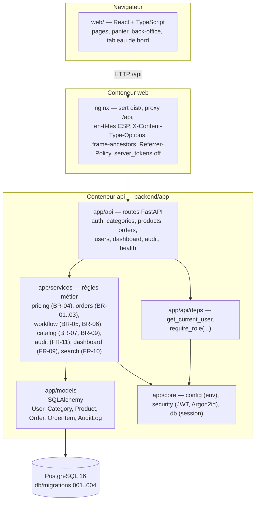
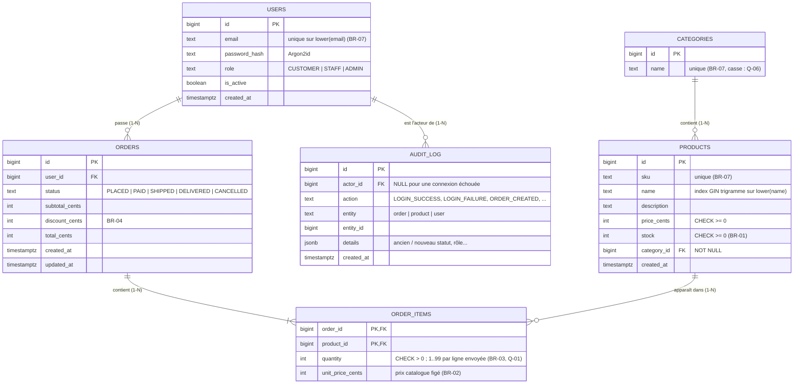
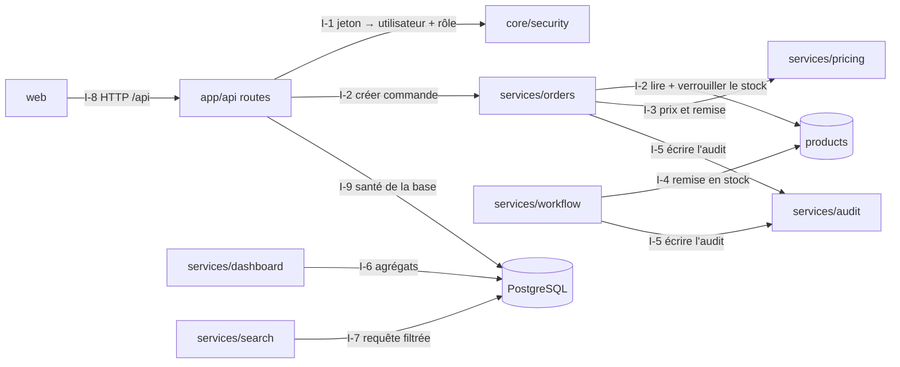
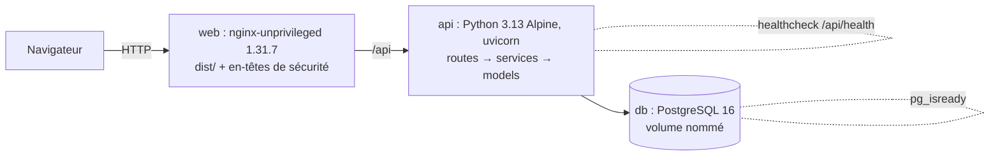

# Rapport de conception — Gestion commerciale

Version 1.0 du 20/11/2026 : conception de la phase 1, complétée en phase 9 avec l'architecture finale (§7).
Exigences : [`exigences.yaml`](exigences.yaml). Plan de test : [`plan-de-test.md`](plan-de-test.md).

## 1. Choix de la pile technique

| Couche | Choix | Justification (cahier §5) |
| --- | --- | --- |
| Backend | Python 3, FastAPI, SQLAlchemy 2, Pydantic | Validation déclarative (422 champ par champ), contrat OpenAPI généré automatiquement, écosystème de test mature (pytest, Schemathesis, Hypothesis, mutmut). |
| Base de données | PostgreSQL 16 | Transactions et verrous de ligne pour le stock (BR-01), contraintes `CHECK`, index trigramme `pg_trgm` pour la recherche sur 50 000 produits. |
| Frontend / auth / déploiement | React + TypeScript (Vite), JWT (HS256, mots de passe Argon2id), Docker Compose | Typage statique côté interface, jeton sans état testable par l'API, installation reproductible sur toute machine avec Docker (§6.8). |

## 2. Architecture en couches

Règle (QR-MA-02) : `api → services → models`, sans import inverse ; complexité cyclomatique <= 10 ;
configuration uniquement par variables d'environnement. Le MVP initial (`app/routers`) a été réorganisé en phase 2
sans changement de comportement ; la règle est vérifiée par import-linter (2 contrats tenus).

Responsabilités : une route valide la forme (schéma Pydantic), vérifie l'identité et le rôle, puis délègue à un
service ; un service applique une règle et ouvre une seule transaction ; un modèle ne contient aucune règle métier.
Les services de calcul (pricing, workflow, dashboard) exposent des fonctions pures testables sans base (niveau CT).

## 3. Modèle de données

La relation N-N exigée par le cahier est `ORDERS` ↔ `PRODUCTS`, portée par `ORDER_ITEMS`. Six entités métier
liées (cahier §4 : au moins quatre). Défense en profondeur pour FR-11 : un déclencheur PostgreSQL refuse
`UPDATE` et `DELETE` sur `audit_log`, en plus de l'absence de route. Migrations : `001_schema`, `002_seed`
(existantes), `003_roles_categories_audit`, `004_volume_seed` (50 000 produits par `generate_series`).

## 4. Carte des interfaces (tests d'intégration)

Chaque flèche est une interface ; chacune a un test de réussite et un test d'erreur (fiche 2, 100 % des
interfaces exercées).

| Interface | De → vers | Données échangées | Réussite | Erreur |
| --- | --- | --- | --- | --- |
| I-1 | routes → sécurité | jeton JWT → utilisateur, rôle | IT-01 | IT-02 |
| I-2 | service commandes → produits (base) | lignes, verrou `FOR UPDATE` par id croissant, stock | IT-03 | IT-04 (panne à la 2e écriture) |
| I-3 | service commandes → tarification | prix catalogue, sous-total → remise → total | IT-05, IT-06 (flux de données) | CT-18 (sous-total invalide) |
| I-4 | workflow → produits | quantités remises en stock | IT-07 | IT-08 |
| I-5 | services → audit | acteur, action, cible, détails, même transaction | IT-09 | IT-10 |
| I-6 | tableau de bord → base | filtres période et catégorie → agrégats | IT-11 | IT-12 (période invalide) |
| I-7 | recherche → base | texte, catégorie, prix, stock, page | IT-13 | IT-14 |
| I-8 | interface web → API | requêtes HTTP via le proxy | E2E-01 | E2E-02 |
| I-9 | API → base (santé) | `SELECT 1` | `/api/health` = 200 (PORT-01) | REL-01 (503 pendant la panne) |

## 5. Contrat de l'API et matrice des droits

Ordre des contrôles sur chaque route (fiche 2) : **identité** (401) → **rôle** (403) → **forme** (422) →
**existence** (404) → **règle métier** (409). Pour un CUSTOMER, la commande d'un autre utilisateur est
« inexistante » (404, BR-08), afin de ne pas révéler qu'elle existe. Le rôle est relu en base à chaque requête :
un jeton émis avant un changement de rôle ou une désactivation porte le rôle courant (SEC-04, Q-08).

Codes attendus quand le rôle est autorisé et la requête valide ; « — » = refusé avec le code indiqué.
Cette matrice est la source de `docs/rbac.yaml` (phase 3, TA-20).

| Méthode et route | Anonyme | CUSTOMER | STAFF | ADMIN | Exigence |
| --- | --- | --- | --- | --- | --- |
| `GET /api/health` | 200 | 200 | 200 | 200 | QR-RE-01 |
| `POST /api/auth/register` | 201 | 201 | 201 | 201 | FR-01 |
| `POST /api/auth/login` | 200 | 200 | 200 | 200 | FR-01 |
| `GET /api/auth/me` | 401 | 200 | 200 | 200 | FR-01 |
| `GET /api/categories`, `GET /api/categories/{id}` | 200 | 200 | 200 | 200 | FR-03 |
| `POST /api/categories` | 401 | 403 | 201 | 201 | FR-03 |
| `PUT /api/categories/{id}` | 401 | 403 | 200 | 200 | FR-03 |
| `DELETE /api/categories/{id}` | 401 | 403 | 204 | 204 | FR-03, BR-09 |
| `GET /api/products`, `GET /api/products/{id}` | 200 | 200 | 200 | 200 | FR-04, FR-10 |
| `POST /api/products` | 401 | 403 | 201 | 201 | FR-04 |
| `PUT /api/products/{id}` | 401 | 403 | 200 | 200 | FR-04 |
| `DELETE /api/products/{id}` | 401 | 403 | 204 | 204 | FR-04, BR-10 |
| `POST /api/orders` | 401 | 201 | 403 | 403 | FR-06 (Q-10) |
| `GET /api/orders` | 401 | 200 (les siennes) | 200 (toutes) | 200 (toutes) | FR-06, FR-07 |
| `GET /api/orders/{id}` | 401 | 200 (sienne) / 404 | 200 | 200 | FR-06, BR-08 |
| `POST /api/orders/{id}/cancel` | 401 | 200 (sienne, PLACED) / 404 | 200 | 200 | FR-06, BR-05, BR-06 |
| `PATCH /api/orders/{id}/status` | 401 | 403 | 200 | 200 | FR-07, BR-05 |
| `GET /api/dashboard` | 401 | 403 | 200 | 200 | FR-09 |
| `GET /api/users` | 401 | 403 | 403 | 200 | FR-05 |
| `PATCH /api/users/{id}/role` | 401 | 403 | 403 | 200 | FR-05, BR-11 |
| `PATCH /api/users/{id}/deactivate` | 401 | 403 | 403 | 200 | FR-05, BR-11 |
| `GET /api/audit` | 401 | 403 | 403 (Q-11) | 200 | FR-11 |
| `GET /api/audit/{id}` | 401 | 403 | 403 | 200 | FR-11 |
| `PUT`, `DELETE /api/audit/{id}` | 405 | 405 | 405 | 405 | FR-11 |

**Format des erreurs.** Erreurs métier et de droits : `{"detail": {"code": "<CODE>", ...champs utiles}}`
(format déjà utilisé par le MVP, conservé pour ne pas changer son comportement), avec les codes `OUT_OF_STOCK`,
`PRODUCT_NOT_FOUND`, `INVALID_TRANSITION`, `DUPLICATE`, `CATEGORY_NOT_EMPTY`, `PRODUCT_IN_USE`, `LAST_ADMIN`,
`NOT_FOUND`, `FORBIDDEN`. Erreurs de
validation (422) : format standard FastAPI, une entrée par champ fautif (`loc`, `msg`, `type`), ce qui permet
d'afficher l'erreur sous le champ concerné (Chapitre I, utilisabilité). Une erreur 500 ne renvoie jamais de
détail technique.

**Robustesse des entrées (ANO-01 à ANO-04).** Les identifiants valent au plus 2^53 − 1 (plus grand entier exact pour un client JavaScript) ; montants et stocks tiennent dans un INTEGER ; aucun texte ne contient le caractère NUL ; les entiers suivent JSON Schema (`5.0` accepté, `false` et `"5"` refusés) ; les dates sont au format ISO. Toute entrée hors de ces bornes reçoit 422, jamais 500. Un corps illisible reçoit 400 (documenté). Une méthode non prévue reçoit 405 avec l'en-tête `Allow` complet.

**Pourquoi 422 et non 400 (BR-03).** La fiche 2 admet le code de refus « selon l'API ». FastAPI et Pydantic
répondent 422 *Unprocessable Content* à un corps bien formé mais invalide, avec le détail par champ ; on garde ce
comportement standard plutôt que de le surcharger, et le contrat OpenAPI le documente (QR-CO-02).

**Recherche (FR-10).** `GET /api/products?q=&category_id=&min_price_cents=&max_price_cents=&in_stock=&limit=&offset=` ; `limit` de 1 à 100 (défaut 20) ; le texte est cherché sans tenir compte de la casse, les jokers `%` et `_` sont échappés ; index trigramme GIN sur `lower(name)` (migration 004).

**Tableau de bord (FR-09).** `GET /api/dashboard?date_from=&date_to=&category_id=`. Le filtre catégorie retient les commandes qui contiennent au moins un produit de la catégorie (comptes par statut, chiffre d'affaires) ; le top 5 et le stock faible ne portent que sur les produits de la catégorie. La liste « stock faible » est limitée à 50 produits, le total est renvoyé à part.

**Montants.** Stockés en centimes entiers ; la remise est calculée en centimes avec arrondi demi vers le haut
(BR-04), jamais en virgule flottante.

**Concurrence (BR-01, QR-RE-02).** La création de commande verrouille les produits concernés
(`SELECT … FOR UPDATE`, ordre d'id croissant pour éviter les interblocages), vérifie le stock, écrit commande,
lignes, stock et audit dans une seule transaction.

## 6. Utilisation de Claude Code

L'application, les tests et les documents sont produits avec Claude Code (modèle Claude Opus 5.5), piloté par
un membre du groupe qui valide chaque phase (11 phases, un commit chacune).

| Aspect | Mise en œuvre |
| --- | --- |
| Règles imposées | `CLAUDE.md` : règle d'or (aucun résultat sans exécution réelle), oracle = règle et jamais le code, traçabilité par identifiants, ordre des contrôles API, architecture en couches. |
| Garde-fous mécaniques | Hook `protect_evidence.py` et règles `deny` : Claude ne peut pas écrire dans `reports/` ni `docs/preuves/` ; seuls les outils y écrivent. Hook de formatage ruff après chaque modification Python. |
| Méthode encodée | Skills projet : `/test-design`, `/gen-tests` (test vu en échec quand la règle est cassée), `/anomalie` (confirmation + non-régression), `/security-triage`, `/trace`, `/phase-done`. |
| Revue indépendante | Sous-agents `test-reviewer` (avant chaque commit de phase) et `evidence-auditor` (avant remise), dans un contexte qui n'a pas produit le travail. Leurs constats sont des revues de code, jamais des résultats d'outil. |
| Contrôle humain | Une phase = un commit ; le pilote lit le diff et la sortie réelle des outils avant de valider ; les risques de sécurité ne sont acceptés que par le groupe. |
| Limites | Les propositions de Claude (questions Q-01 à Q-12) ne deviennent des règles qu'après validation humaine ; les résultats d'utilisabilité et l'installation sur une seconde machine viennent de personnes, pas de l'outil. |
| Apport mesuré | Les défauts ont été trouvés par des outils exécutés (Schemathesis, Playwright mobile, radon, règles cassées, mutation) et non par affirmation ; les revues de Claude (`/security-review`, sous-agents) sont consignées comme revues de code dans [`securite/triage.md`](securite/triage.md) et [`journal.md`](journal.md). |

## 7. Architecture finale et écarts par rapport à la conception initiale

La structure du §2 est conservée. Changements apportés pendant la campagne, chacun lié à son anomalie :

| Changement | Emplacement | Origine |
| --- | --- | --- |
| Types d'entrée bornés (identifiant <= 2^53-1, refus des booléens comme entiers, refus du caractère NUL, dates ISO strictes) partagés par toutes les routes | `app/api/types.py` | ANO-01, ANO-02, ANO-03 |
| Gestionnaire d'erreurs central : 405 avec en-tête `Allow` complet (table des routes lue depuis OpenAPI), 503 `DATABASE_UNAVAILABLE` avec `Retry-After` si la base tombe, 500 générique sans détail interne | `app/api/errors.py`, `app/api/route_table.py` | ANO-04, QR-RE-01 |
| Codes d'erreur documentés route par route dans le contrat | `app/api/responses.py` | ANO-05 |
| Tableau de bord découpé en trois fonctions (complexité 11 → 9 au plus) | `app/services/dashboard.py` | ANO-08 |
| Liste des commandes paginée et filtrée par statut côté API (`limit` 1 à 200, `offset`) | `app/services/orders.py`, `routes/orders.py`, `web/src/pages/AdminOrdersPage.tsx` | ANO-09 |
| Mise en page mobile : tableaux défilants, champs bornés, mots longs coupés | `web/src/index.css` | ANO-07, ANO-10 |
| Identifiants en `BIGINT` côté ORM | `app/core/db.py` (`type_annotation_map`) | ANO-01 |
| En-têtes de sécurité (CSP, COOP/COEP/CORP, nosniff, Referrer-Policy, Permissions-Policy) dans nginx et l'API | `web/nginx.conf`, `app/main.py` | tri ZAP |
| Images durcies : Alpine mise à jour, pip et setuptools retirés, utilisateurs non root (10001, 101), healthchecks | `backend/Dockerfile`, `web/Dockerfile`, `docker-compose.yml` | tri Trivy |
| `/api/health` répond 503 quand la base est indisponible ; politique `restart: unless-stopped` | `app/main.py`, `docker-compose.yml` | QR-RE-01 |

Mesures de l'architecture finale : [`conformite.md`](conformite.md) §7 (couches, complexité, couverture, mutation)
et §8 (installation).
